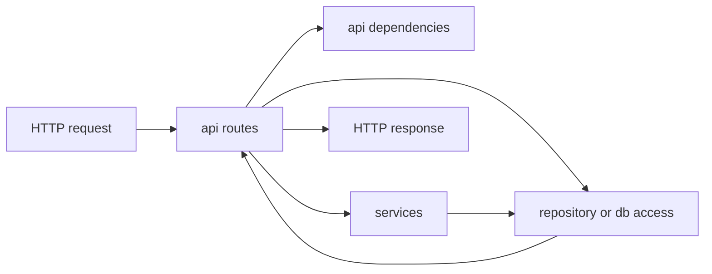

# API Boundary and HTTP Routing

The `api/` package is the **presentation layer** and acts as the system’s HTTP boundary. Its responsibility is to translate incoming request data into application-level calls, and translate results back into response shapes, without exposing persistence concerns or domain internals to the outside world.

The route modules are organized by resource:

- `api/routes/users.py`
- `api/routes/bookings.py`
- `api/routes/destinations.py`

This grouping makes the HTTP surface explicit and keeps each route module focused on one slice of the API.

## Role of the route layer

Across the route modules, the same architectural pattern appears repeatedly:

1. accept request data in schema form or primitive parameters,
2. obtain a service or repository through `api/dependencies.py`,
3. invoke application logic,
4. map the result into a response payload.

That makes the route layer an **adapter**, not a place for business logic. For example, the booking routes delegate booking creation and cancellation to `BookingService`, then only format the returned booking into a response. Likewise, the user routes validate input, call the repository, and return a response DTO-like object rather than a persistence model.

## Route grouping by resource

### Users

`api/routes/users.py` defines the HTTP-facing operations around user registration and lookup. Architecturally, it shows two important boundaries:

- request validation is kept at the edge using `schemas.user.UserCreateRequest`
- response shaping is handled with `schemas.user.UserResponse`

It also performs a small amount of presentation-layer validation before touching persistence, such as email format checking through `utils.validators.is_valid_email`, and password hashing through `core.security.hash_password`. This is still boundary work: the route prepares data for storage, but does not own storage logic itself.

### Bookings

`api/routes/bookings.py` is the clearest example of the API layer as a thin orchestration boundary. It:

- receives `schemas.booking.BookingCreateRequest`
- acquires `BookingService` through `get_booking_service`
- delegates booking creation, listing, and cancellation
- catches shared domain exceptions and turns them into error payloads

This module deliberately avoids repository access except for presentation shaping. The only direct data source it touches outside the service layer is the database/session accessor used to enrich responses with destination city names. That is still a boundary concern: the route is converting internal booking data into a client-friendly representation.

### Destinations

`api/routes/destinations.py` is a lightweight read-only boundary over destination data. It exposes destination listing and lookup as simple HTTP-facing functions and formats the returned data into dictionaries. Unlike bookings, it does not route through a business service, which suggests destination data is treated as direct reference data in this repository’s current architecture.

## Shared wiring through dependencies

`api/dependencies.py` provides route-level wiring functions:

- `get_booking_service`
- `get_user_repository`

This is a small dependency-injection seam. The code comments explicitly describe it as analogous to `Depends()` in a real FastAPI application, which indicates an intentional pattern: route modules do not construct their collaborators directly. Instead, they request prebuilt instances from a shared composition helper.

That choice improves separation in two ways:

- route modules stay focused on HTTP adaptation
- instantiation details can be centralized and changed without rewriting route logic

The current implementation is simple and explicit, returning concrete instances directly. Even so, the design already establishes a dependency boundary that can support more advanced wiring later.

## Data shaping conventions at the boundary

The API layer uses a mix of schemas and plain dictionaries:

- schema objects for structured input and output where validation matters
- dictionaries for simple error payloads and lightweight read responses

This indicates a pragmatic boundary style rather than a fully uniform response framework. The consistent pattern is not a specific transport abstraction, but the separation of concerns: HTTP-facing code owns request/response translation, while business decisions and persistence concerns remain elsewhere.

## Architectural summary

In this repository, the API layer is an **adapter layer**. It:

- organizes the HTTP surface by resource
- performs basic request validation and response formatting
- delegates business operations to services
- relies on shared dependency helpers for wiring
- avoids leaking repository or ORM details into the presentation boundary

That role makes the API layer the entry point to the application, but not the place where application rules live.