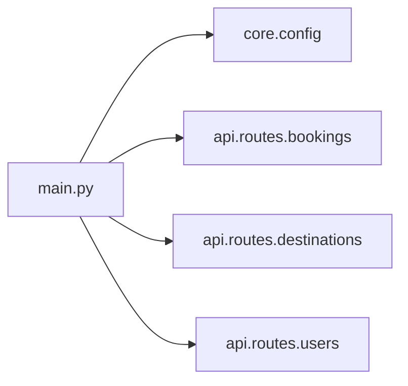

# Application Entry Point and Assembly

`main.py` is the repository’s **composition root**: the place where the application is assembled into a runnable unit, while the rest of the codebase remains layered and decoupled until runtime. In this project, that assembly is intentionally lightweight and explicit.

## Startup responsibility

According to the README, TravelHub follows a layered architecture:

- `api` handles HTTP presentation
- `services` contains business orchestration
- `database` provides persistence
- `schemas` defines data contracts
- `core` holds configuration and other cross-cutting concerns

`main.py` is the module that brings those pieces together. It does not implement domain logic itself; instead, it imports the route groups from `api.routes` and the runtime settings from `core.config`, then exposes a single `create_app` entry point.

## Composition at runtime

The `create_app` function performs the minimal wiring required to make the application runnable:

- loads settings through `get_settings`
- registers the available route groups
- emits startup information based on the configured application name and environment

This keeps the startup concern separate from the implementation details of the routes, services, and persistence layer. The application is therefore assembled at the edge, rather than by hard-coding dependencies throughout the codebase.

The current implementation is intentionally simple: it returns a route registry rather than instantiating a full web framework object. Architecturally, though, it still plays the role of the bootstrapping layer that connects the presentation surface to the configured runtime environment.

## What stays decoupled until startup

The entry point does **not** define or embed the internal structure of the lower layers:

- route modules remain independent until imported here
- configuration is resolved at startup rather than globally hard-coded
- persistence and service dependencies are not assembled inside the domain modules themselves

That separation preserves testability and makes each layer usable in isolation. It also matches the repository’s broader design: infrastructure is wired at the top, while business logic and data access stay focused on their own responsibilities.

## Environment preparation

`check_env.py` is a separate, ad hoc environment-check script. Its purpose is not application assembly, but **preflight validation**: it checks whether required environment variables are present before the project is started locally.

Architecturally, this script sits outside the normal application flow:

- it is not imported by `main.py`
- it does not participate in request handling
- it does not configure services, routes, or persistence

Instead, it serves as a lightweight safeguard around startup by verifying prerequisites such as `DATABASE_URL` and `ENVIRONMENT`. The file itself notes that it is a developer utility and that it does not follow the project’s standard conventions, which reinforces its role as an auxiliary check rather than part of the production composition model.

## Assembly boundaries

Taken together, `main.py` and `check_env.py` show two distinct startup concerns:

1. **Environment readiness** via `check_env.py`
2. **Application wiring** via `main.py`

This separation keeps operational validation distinct from runtime composition. The result is a clearer bootstrapping path: first confirm the process can run, then assemble the API from the configured layers.

## Architectural summary

- `main.py` is the startup composition root.
- `core.config` provides the runtime settings consumed at boot.
- `api.routes` supplies the HTTP surface that gets registered.
- `check_env.py` is a standalone environment guard, not part of the application flow.
- The lower layers remain decoupled until startup, preserving the layered architecture described in the README.