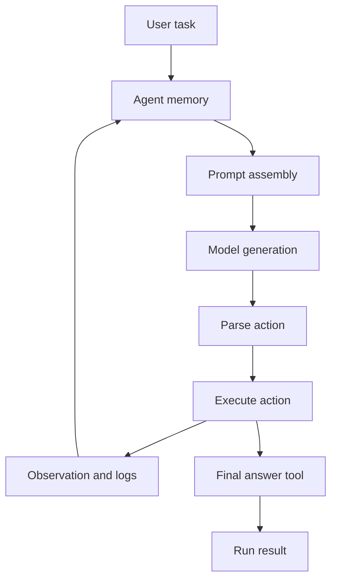

# Architecture Overview and Core Loop

smolagents is organized around a deliberately small agent core rather than a broad application layer. The central architectural idea is that **agent behavior lives in a compact orchestration loop**, while models, tools, execution backends, and UI entry points remain swappable at the edges. The main abstractions are [`CodeAgent`](#) and [`ToolCallingAgent`](#) in `src/smolagents/agents.py`, which share the same multi-step control skeleton through `MultiStepAgent` but differ in how they express actions.

At a high level, the framework is built around a repeated **task → model output → action execution → observation → next step** cycle. This is the classic ReAct pattern, but smolagents adapts it to two execution styles:

- **`ToolCallingAgent`** uses the model’s native tool-call interface and expects structured tool calls.
- **`CodeAgent`** asks the model to write actions as Python code snippets, then parses and executes that code.

The README explicitly frames this as “agents that think in code,” and the implementation follows that philosophy by keeping the core loop small while still handling the non-trivial glue: prompt construction, action extraction, tool invocation, memory updates, and final-answer handling.

## Shared orchestration layer

`MultiStepAgent` provides the common execution scaffold for both agent styles:

- it prepares the system prompt and prompt templates,
- initializes memory,
- runs optional planning steps,
- executes repeated action steps until a final answer is produced or the step limit is reached,
- and records the full run for later inspection or serialization.

This shared base is what makes the architecture compact. The child agents specialize only the parts that differ: how the prompt is written, how the model output is interpreted, and how the action is executed.

## Two execution styles

### `ToolCallingAgent`

`ToolCallingAgent` represents the structured tool-calling path. Its prompt template in `src/smolagents/prompts/toolcalling_agent.yaml` tells the model to emit explicit tool-call blobs, with `final_answer` as the terminal tool. The agent then:

1. sends the current memory as input messages,
2. asks the model for tool calls,
3. validates and executes those calls,
4. stores tool outputs as observations,
5. and treats a `final_answer` tool call as completion.

This path is appropriate when the model/provider already supports tool calling, and it keeps the action format close to the provider’s native capabilities.

### `CodeAgent`

`CodeAgent` is the more distinctive execution style. The prompt in `src/smolagents/prompts/code_agent.yaml` asks the model to produce alternating **Thought / Code / Observation** steps, where tool usage happens through normal Python function calls. The code is parsed, executed through a Python executor, and its logs or returned values become the next observation.

The result is a ReAct-like loop with a code-centric action format:

- the model reasons in natural language,
- expresses the next step as executable code,
- the executor runs that code,
- and the output is fed back into memory for the next iteration.

This design is what the README highlights as the library’s core novelty: actions are not only “tool calls,” they can be written as code, which gives the agent a more expressive intermediate language while preserving the same loop structure.

## Prompt templates as architectural contracts

The prompt templates in `src/smolagents/prompts/` are not just examples; they are part of the architecture. They define the contract between the orchestration layer and the model:

- **system prompts** define the action format and behavioral rules,
- **planning prompts** define how optional planning steps are inserted,
- **final-answer prompts** define how the agent is asked to produce the final response when the loop ends,
- and the code-agent variants define whether the model should emit plain code blocks or structured code payloads.

`CodeAgent` also supports a structured-output variant via `structured_code_agent.yaml`, which changes the model-facing format without changing the outer control loop. That is a good example of the framework’s minimal-core philosophy: the execution skeleton remains stable, while prompt format and parsing strategy can vary.

## Memory is part of the loop, not a passive log

The agent memory is used as active input to subsequent model calls. In `MultiStepAgent.write_memory_to_messages`, past system, task, planning, action, and observation steps are reconstructed into chat messages. This means memory is not only for inspection after the run; it is the substrate that makes the next step possible.

That design has two important consequences:

- the agent can rebuild context consistently at every step,
- and the same memory can later be replayed, serialized, or summarized.

In other words, memory is an execution dependency, not an afterthought.

## Final answer handling

Both agent styles converge on the same termination concept: the loop ends when the agent produces a final answer. For `ToolCallingAgent`, this is the `final_answer` tool call. For `CodeAgent`, the code execution layer recognizes the `final_answer` call inside the executed snippet.

The final answer is then wrapped into the agent’s output handling, which also supports modality-aware return types through `src/smolagents/agent_types.py`. That module defines output wrappers such as `AgentText`, `AgentImage`, and `AgentAudio`, so the framework can preserve the semantics of non-text results while still treating them as agent outputs. This is part of the same architectural idea: the core loop stays generic, while output typing is handled through a narrow abstraction boundary.

## Planning as an optional overlay

`MultiStepAgent` also supports periodic planning steps. These are not a separate agent type; they are an additional control-flow phase inserted into the same run loop at a configurable interval. Planning uses dedicated prompt sections and a separate memory reconstruction mode, so the agent can refresh its strategy without changing its core execution pattern.

That choice reflects the repository’s overall design stance: add structure only where it improves control and reuse, but do not split the framework into many specialized subsystems unless the behavior truly differs.

## Why this core is reusable

The core loop is reusable because it is defined in terms of a few stable responsibilities:

- format context into prompts,
- ask the model for the next move,
- parse the move into an executable action,
- run the action,
- convert the result into observation,
- and repeat until completion.

`CodeAgent` and `ToolCallingAgent` are therefore not separate products; they are **two execution encodings over the same agent framework**. The rest of the repository extends this core with model adapters, tools, memory/serialization, and executors, but the orchestration logic remains centralized and small.

In practice, that is the architectural tradeoff smolagents makes: keep the agent kernel minimal, but make the surrounding contracts explicit enough that the same kernel can support code-based agents, native tool-calling agents, multimodal outputs, optional planning, and different execution backends without rewriting the control flow.