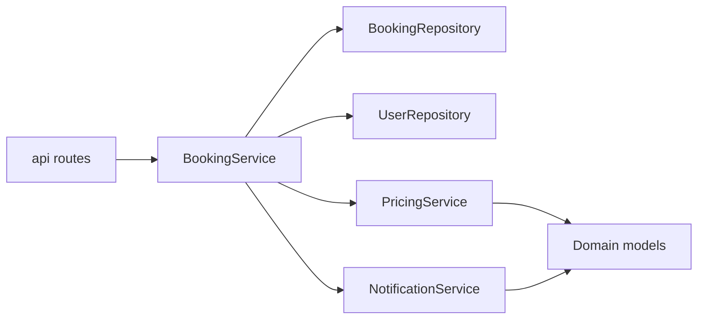

# Business Services and Use-Case Orchestration

The `services/` layer is the application’s business orchestration boundary: it concentrates booking rules, pricing policy, and user-facing notifications in one place, away from the HTTP layer and away from persistence details. In TravelHub, this layer is intentionally small and practical: it looks like a classic **application-service style**, where each service module coordinates lower-level components to execute a use case.

## Role of the service layer

The service layer sits between the API adapters and the repository layer:

- it receives intent from the HTTP layer,
- validates and enforces business rules,
- coordinates repositories and helper functions,
- returns domain objects or raises domain-specific exceptions.

This keeps the API thin and keeps the database layer focused on storage concerns. The result is a clearer separation between:

- **presentation concerns**: request parsing, response shaping, HTTP status codes,
- **business concerns**: booking limits, date validity, price calculation, notification messaging,
- **persistence concerns**: loading and storing `Booking` and `User` records.

## BookingService as the main use-case coordinator

`services/booking_service.py` is the central orchestration point for the booking workflow. It owns the main application use cases around reservations:

- creating a booking,
- cancelling a booking,
- listing bookings for a user.

That module is not just a thin wrapper around persistence. It combines several responsibilities that belong together at the use-case level:

- **business validation**: it checks that the booking dates form a valid range using shared date helpers;
- **policy enforcement**: it enforces the configured limit on active bookings per user;
- **composition of collaborators**: it uses the booking repository, the user repository, and the pricing helper;
- **state transition management**: it creates bookings in a pending state and updates existing bookings to cancelled.

A notable architectural choice is that `BookingService` loads configuration through `core.config` and applies the booking limit from runtime settings. That means the booking policy is not hardcoded into the API route or repository; it is part of the service-level business rule.

The service also depends on a price calculation helper rather than embedding pricing logic inline. This keeps booking orchestration distinct from pricing policy, while still making the booking workflow responsible for assembling the final `Booking` object before persistence.

### What stays out of BookingService

`BookingService` does **not**:

- translate HTTP payloads,
- manage database session lifecycle,
- implement SQL or ORM queries,
- format response bodies.

Those responsibilities remain in the API, repository, and schema layers respectively. This is what makes the service layer the right place for use-case orchestration.

## PricingService as a focused domain helper

`services/pricing_service.py` is a smaller, pure calculation-oriented module. It encapsulates the pricing rules used by booking creation:

- compute the number of nights,
- derive a subtotal from destination base price, stay length, and passenger count,
- apply a long-stay discount,
- reject invalid date ranges by raising a plain `ValueError`.

This module is a good example of separating a business rule from a workflow. It does not know about bookings, repositories, users, or notifications. It only knows how to transform booking inputs and a `Destination` into a price.

That design has two benefits:

1. **Reuse**: any workflow that needs pricing can rely on the same calculation logic.
2. **Testability**: the pricing policy can be validated independently from persistence and orchestration.

The discount rule is encoded here rather than in the booking service, which means the booking workflow delegates the economic policy to a dedicated helper. This is a clean separation between:

- **workflow orchestration** in `BookingService`,
- **pricing rules** in `pricing_service.py`.

## NotificationService as an output-oriented supporting service

`services/notification_service.py` represents a supporting concern rather than a core domain workflow. Its responsibility is to produce notification messages for booking state changes:

- confirmation,
- cancellation.

The module builds messages from `User` and `Booking` objects and currently emits them through a simple `print` side effect. Architecturally, this places notifications outside the persistence and API layers while keeping message construction tied to business events.

Even though the implementation is minimal, it still shows an important pattern: notifications are treated as a separate service concern, not as part of booking persistence or HTTP response generation. That keeps outbound communication logic isolated from the core booking workflow.

## Responsibility split across service modules

Taken together, the service modules suggest a straightforward orchestration structure:

- `BookingService` = main application service and workflow coordinator
- `pricing_service.py` = reusable pricing policy
- `notification_service.py` = event-adjacent outbound messaging helper

This is not a rich domain model with many collaborating entities in the service layer. Instead, it is a **simple application-service architecture** where the booking service orchestrates a handful of focused helpers. That is a deliberate fit for a small REST API: the business rules are centralized without introducing unnecessary abstraction.

## How the services collaborate

The booking workflow shows the intended direction of dependencies:

1. the API asks the booking service to create or cancel a booking;
2. the booking service validates business rules;
3. it delegates pricing to the pricing helper;
4. it persists state through repositories;
5. other services, such as notifications, can react to the resulting domain objects.

This keeps the use-case logic cohesive while allowing supporting concerns to remain modular.

### Architectural boundaries

| Concern | Lives in |
| --- | --- |
| HTTP request handling | API layer |
| Booking policy and workflow | `BookingService` |
| Price calculation | `pricing_service.py` |
| Notification message generation | `notification_service.py` |
| Data persistence | repository layer |

## Relationship to the rest of the architecture

This service layer is the main bridge between the outer API and the inner data model. It depends on the persistence layer for retrieval and storage, but it does not expose ORM or SQL details upward. It also depends on shared utilities and configuration for rules that should remain consistent across use cases.

For the broader request path and layer boundaries, see [Layered Architecture and Request Flow](Layered-Architecture-and-Request-Flow.md). For the persistence boundary that these services rely on, see [Persistence Layer and Repository Pattern](Persistence-Layer-and-Repository-Pattern.md).