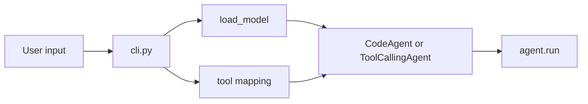
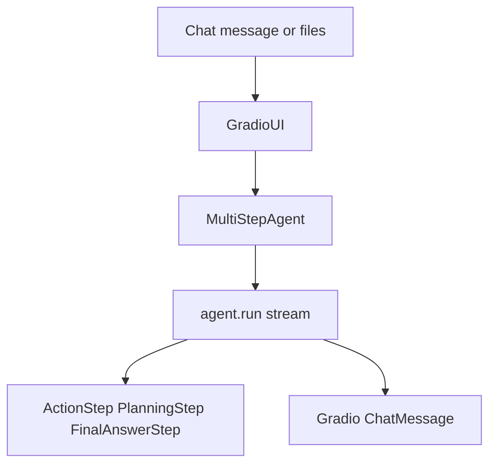

# CLI, UI, and Library Assembly

`smolagents` exposes its user-facing surface through thin composition layers rather than through separate application stacks. The CLI and Gradio interface both assemble the same underlying agent, model, tool, and execution primitives, which keeps behavior centralized in the core library and places configuration at the edges. This is consistent with the package export surface in `src/smolagents/__init__.py`, where the main agent classes, models, tools, executors, and UI helpers are re-exported as the intended public API.

## CLI as a wiring layer

The CLI in `src/smolagents/cli.py` is primarily an orchestration entry point. It parses user configuration, resolves model and tool choices, instantiates an agent, and then delegates execution to that agent.

Architecturally, the CLI does three things:

1. **Collects runtime configuration**
   - command-line arguments for prompt, model type, model ID, imports, tools, provider settings, and action style
   - interactive setup when no prompt is provided
2. **Maps configuration to library objects**
   - model selection is normalized through `load_model`
   - tool names are resolved through `TOOL_MAPPING` or converted into Space-backed tools
   - the action style determines whether `CodeAgent` or `ToolCallingAgent` is created
3. **Delegates execution**
   - the CLI never implements agent logic itself
   - it calls `agent.run(prompt)` after composing the object graph

The interactive branch is especially illustrative: it presents a wizard for selecting action type, tools, model family, provider settings, and optional imports, but all of those choices are still reduced to the same underlying agent constructors used by non-interactive mode.

### What the CLI reveals about the architecture

The CLI is not a separate execution engine. It is an assembly surface over the shared core:
- **model selection** is abstracted behind the common model API
- **tool selection** is data-driven through a mapping layer
- **agent style** is a constructor choice, not a different application subsystem

This is why the CLI can support both scripted invocation and an interactive wizard without duplicating any multi-step orchestration logic.

The README’s CLI section reflects the same design: `smolagent` and `webagent` are described as command-line entry points that configure and launch existing agent machinery, not as standalone applications.

## Gradio UI as a presentation adapter

`src/smolagents/gradio_ui.py` plays the same architectural role for the web UI. It converts agent state into Gradio chat events, handles file uploads, and streams outputs into a chat interface, but it does not own the agent loop itself.

The module is structured around three responsibilities:

- **stream adaptation**
  - `stream_to_gradio` consumes the agent’s streamed events and converts them into Gradio messages
  - `pull_messages_from_step` formats `ActionStep`, `PlanningStep`, and `FinalAnswerStep` into UI-friendly artifacts
- **presentation formatting**
  - model output, tool calls, logs, images, audio, and final answers are rendered into chat messages
  - step metadata such as token usage and duration is surfaced for inspection
- **UI assembly**
  - `GradioUI` wraps an existing `MultiStepAgent`
  - it creates the `gr.ChatInterface` and wires it to the agent’s `run` method

This makes the Gradio layer an adapter over the same core runtime state used everywhere else. The UI does not invent a new execution model; it only translates agent events into a browser-friendly presentation.

### UI data flow

### File upload and multimodal assembly

`GradioUI` also manages uploaded files by optionally copying them into a configured upload folder and passing their paths back into the agent call. That makes file handling part of the UI composition layer rather than part of the agent core. The agent still receives inputs through its normal multimodal interface; the UI only prepares and forwards them.

The example in `examples/gradio_ui.py` shows the intended usage pattern clearly: create a `CodeAgent`, configure its model and tools, and then pass that already-assembled agent into `GradioUI(...).launch()`. That is a strong signal that the UI is a consumer of the library core, not a host for bespoke agent behavior.

## Public API and package assembly

`src/smolagents/__init__.py` defines the package’s assembly story at import time. By re-exporting core agent classes, models, tools, memory types, executors, serialization utilities, and UI helpers, it presents the library as a compact unified surface.

From an architectural point of view, this does two things:

- **keeps consumption simple**
  - users can import `CodeAgent`, `GradioUI`, `InferenceClientModel`, tools, and other building blocks from the top-level package
- **signals intentional composition**
  - the package is meant to be assembled from reusable parts
  - the top-level namespace mirrors the framework’s modular boundaries

This public surface also reinforces the edge/core split:
- the **core** contains the shared agent and model behaviors
- the **edge** contains convenience entry points such as CLI and UI assembly

## Tests as evidence of the composition contract

The test suite confirms that these entry points are thin integration layers:

- `tests/test_cli.py` verifies that `load_model` returns the expected model adapter for each configured backend, and that `run_smolagent` wires the selected model and agent constructor correctly before invoking `run`.
- `tests/test_gradio_ui.py` checks that the Gradio helpers transform agent steps into UI messages, that file upload handling is isolated, and that streaming passes the right parameters through to `agent.run`.

That test shape matters architecturally: it validates the assembly contract without requiring the CLI or UI to reimplement any agent semantics.

## Summary

The CLI, Gradio UI, and top-level package exports all point to the same design principle: `smolagents` is a reusable agent framework with a compact shared core, and its user-facing interfaces are primarily composition layers. Configuration, packaging, and presentation live at the boundary; the behavior of the agent system remains centralized in the shared core described in [Architecture Overview and Core Loop](Architecture-Overview-and-Core-Loop.md).