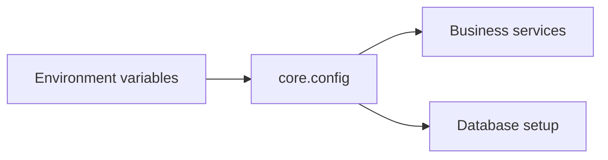
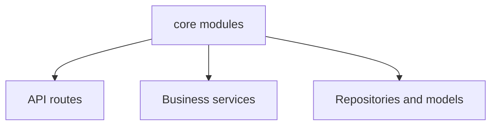

# Cross-Cutting Concerns: Configuration, Security, and Exceptions

`core/` contains infrastructure that is intentionally **orthogonal** to the main request, business, and persistence flow. Instead of embedding environment handling, credential logic, or error taxonomy inside services or routes, TravelHub centralizes those concerns in three focused modules:

- `core/config.py` for runtime settings
- `core/security.py` for authentication-related primitives
- `core/exceptions.py` for application-specific error signaling

This separation improves cohesion in the feature layers and keeps shared operational concerns available wherever they are needed.

## Configuration

`core/config.py` defines a small configuration object, `Settings`, that captures values that vary by deployment environment:

- application identity
- runtime environment
- database connection URL
- business limit for active bookings per user

The module instantiates a singleton-style settings object and exposes it through `get_settings`, which makes configuration retrieval consistent across the codebase.

### Architectural role

Configuration is treated as **shared input to the system**, not as business logic. That means:

- services and repositories can depend on `Settings` without knowing how values are sourced
- environment-specific values are kept out of feature code
- defaults are centralized in one place, which reduces drift between development and production setups

This is especially important for the persistence layer, where `database_url` becomes the bridge between deployment configuration and session setup, and for booking logic, where `max_bookings_per_user` expresses a global policy rather than a local rule.

## Security utilities

`core/security.py` isolates low-level credential and token helpers:

- `hash_password` transforms plaintext passwords into salted hashes
- `verify_password` checks a plaintext password against a stored hash
- `generate_session_token` produces a random session token

### Architectural role

These functions keep security mechanics out of domain orchestration. The business layer can rely on them as primitives without having to know:

- which hashing algorithm is used
- how salts are generated and stored
- how session tokens are produced

That separation matters because security concerns are **cross-cutting**: they may be used by user management, login flows, session creation, or future account features, but they should not become embedded as special cases inside unrelated booking logic.

The module also avoids coupling security concerns to the database or HTTP layers. It provides reusable primitives that can be called wherever credential handling is needed, while the rest of the system remains focused on its own responsibilities.

## Shared exceptions

`core/exceptions.py` defines the application’s canonical error types:

- `TravelHubError` as the base class
- `BookingNotFoundError`
- `InvalidBookingDatesError`
- `UserNotFoundError`
- `BookingLimitExceededError`

### Architectural role

These exceptions create a **domain-level error vocabulary** that can be raised from any layer without leaking implementation details. Instead of allowing generic Python exceptions or ORM-specific failures to define control flow, the application can signal business-relevant problems explicitly.

This has two main effects:

1. **Consistent error semantics**  
   Callers can distinguish expected business failures from unexpected technical failures.

2. **Stable boundary behavior**  
   API code can map these exceptions to HTTP responses in a uniform way, without hard-coding business rules into route handlers.

The exception hierarchy also makes error handling composable: a single catch for `TravelHubError` can cover all application-defined failures, while more specific subclasses preserve meaning for booking and user workflows.

## Why these concerns live in `core/`

Placing these modules outside the main feature layers keeps the architecture cleanly separated:

- `api/` handles HTTP adaptation
- `services/` coordinates use cases
- `database/` handles persistence
- `core/` provides shared infrastructure and policies

This avoids duplication, keeps business modules focused on their own responsibilities, and makes the application easier to evolve. Configuration, security primitives, and exception types become reusable building blocks rather than hidden dependencies scattered throughout the codebase.

