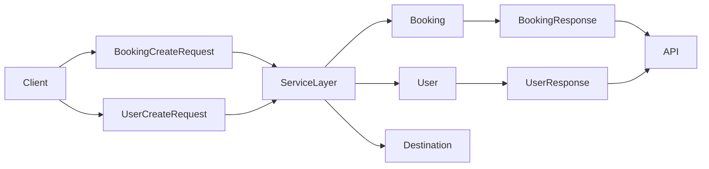

# Domain Models, Schemas, and Data Contracts

TravelHub separates its domain vocabulary into two complementary kinds of types:

- **Persistence models** in `database/models.py`, which describe how entities are stored internally.
- **Boundary schemas** in `schemas/booking.py` and `schemas/user.py`, which define the data the API accepts and returns.

This separation is part of the repository’s layered architecture described in the README: the database layer owns stored state, while the schema layer acts as the contract between the API and the rest of the system.

## Persistence models

`database/models.py` defines the core stored entities as plain dataclasses:

- `User`
- `Destination`
- `Booking`
- `BookingStatus`

These types represent the **internal domain shape** as persisted by the application. They are not presented as request/response contracts; instead, they capture the state that the rest of the system works with after data has entered the application.

A few architectural properties stand out:

- `BookingStatus` centralizes the allowed booking lifecycle states as an enumeration.
- `Booking` carries the foreign-key style relationships that connect a booking to a user and a destination through `user_id` and `destination_id`.
- `Booking` also stores operational state such as `check_in`, `check_out`, `total_price`, `status`, and `passengers`, which indicates that pricing and booking lifecycle are tracked in the persisted model rather than recomputed only at the boundary.
- `User` contains the authentication-oriented field `hashed_password` and an `is_active` flag, showing that the stored user record includes both identity and account state.
- `Destination` holds the pricing-relevant `base_price`, which makes destinations part of the data model used by booking and pricing workflows.

Because these are dataclasses with no business methods, they behave as **state containers**, not behavior carriers.

## Boundary schemas

The `schemas` package defines the shapes used for API input and output.

### Booking schemas

`schemas/booking.py` contains:

- `BookingCreateRequest`
- `BookingResponse`

`BookingCreateRequest` models what the API needs from a client to create a booking. It intentionally includes only the client-controlled fields:

- `user_id`
- `destination_id`
- `check_in`
- `check_out`
- `passengers`

This keeps persistence details out of the request contract. For example, clients do not provide booking identifiers, status values, or total price directly.

`BookingResponse` represents the outward-facing booking shape returned by the API. It is narrower and intentionally different from the persistence model:

- `id`
- `destination_city`
- `check_in`
- `check_out`
- `total_price`
- `status`

This indicates a transformation layer between stored booking data and the API response. The response shape exposes a user-friendly destination label rather than a raw destination identifier, and it returns `status` as a string instead of the internal enum type.

### User schemas

`schemas/user.py` contains:

- `UserCreateRequest`
- `UserResponse`

`UserCreateRequest` captures registration data from the API boundary:

- `full_name`
- `email`
- `password`

This is distinct from the stored `User` model, which keeps `hashed_password` instead of a plain password. That difference is an important contract boundary: hashing is an internal concern, not part of the public shape.

`UserResponse` is the sanitized output view of a user:

- `id`
- `full_name`
- `email`

Notably absent are password-related fields and internal account metadata. This reflects a deliberate exposure rule: the API returns identity information, not authentication internals.

## Relationship between models and schemas

The three files together imply a consistent data flow:

1. **Client input** arrives in schema form.
2. **Services** convert validated input into internal models and orchestrate business rules.
3. **Persistence models** represent the stored entities.
4. **Response schemas** project the internal state back into an API-safe shape.

This design keeps the contracts stable at the boundary while allowing internal state to evolve independently.

## Domain consistency and invariants

The code suggests several domain-level invariants, even though the enforcement likely happens elsewhere in the application:

- A booking must belong to exactly one user and one destination through their identifiers.
- Booking dates are represented as `date`, which signals that date semantics are important at the model level.
- Booking status is constrained to a small closed set via `BookingStatus`.
- User creation and user storage use different password representations, preserving a security boundary between input and persistence.
- The response models are intentionally narrower than the persistence models, indicating that the API exposes only the data needed by clients.

## Architectural role of these types

Together, these models and schemas form the project’s **data contract layer**:

- `database/models.py` defines what the system stores.
- `schemas/booking.py` and `schemas/user.py` define what the system accepts and returns.
- The transformation between them is what keeps the API cleanly separated from persistence concerns.

This separation supports the layered architecture documented in [Layered Architecture and Request Flow](Layered-Architecture-and-Request-Flow.md) and is closely related to the responsibilities of [Business Services and Use-Case Orchestration](Business-Services-and-Use-Case-Orchestration.md) and [Persistence Layer and Repository Pattern](Persistence-Layer-and-Repository-Pattern.md).