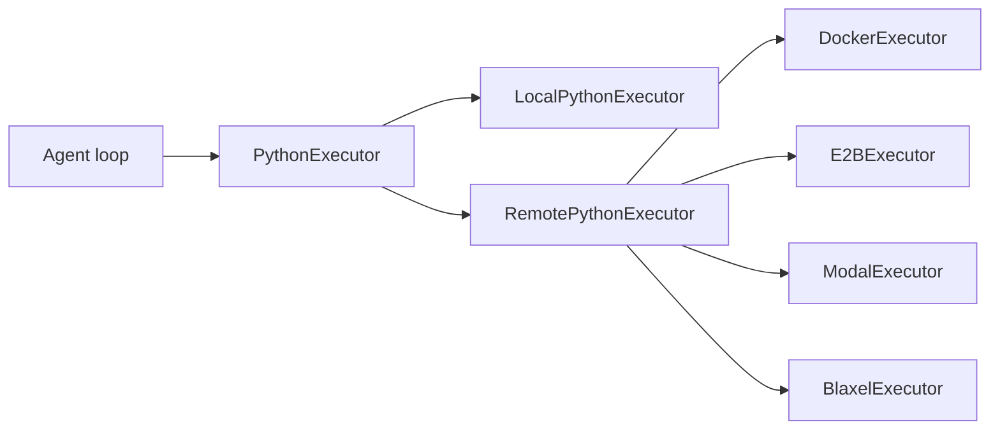

# Execution Backends and Security Boundary

The execution layer is a distinct subsystem in **smolagents**: it is responsible for running agent-generated Python code, but it is intentionally separated from the agent orchestration loop itself. The repository exposes multiple executor implementations behind a shared `PythonExecutor` contract in `src/smolagents/local_python_executor.py` and `src/smolagents/remote_executors.py`. This makes code execution an interchangeable architectural dependency rather than a hard-coded behavior inside the agents.

## Two execution modes

At a high level, the package splits execution into:

- **Local execution** for developer convenience and fast iteration
- **Remote or sandboxed execution** for isolation and safer deployment

The local path is implemented by `LocalPythonExecutor`, which evaluates Python code in-process with a constrained interpreter. The remote path is implemented by `RemotePythonExecutor` and backend-specific subclasses such as `DockerExecutor`, `E2BExecutor`, `ModalExecutor`, and `BlaxelExecutor`. These backends all share the same user-facing role: run code, return logs, return a result, and signal whether that result should be treated as the final answer.

## Local executor: constrained, but not a sandbox

`LocalPythonExecutor` is the lightweight implementation used for local development and testing. It embeds a restricted Python evaluator that:

- tracks state across executions
- exposes an explicit tool set to generated code
- captures print output separately from return values
- enforces a timeout
- restricts imports and access to dangerous built-ins and dunder attributes

The implementation in `src/smolagents/local_python_executor.py` shows that this executor is designed to reduce accidental misuse, not to guarantee isolation. The class docstring is explicit that it **is not a security sandbox**. The security model is defense-in-depth at the interpreter level: it limits imports, blocks obvious escape hatches, and validates access to known-dangerous functions, but it still runs in the local process.

The test suite reinforces that distinction. `tests/test_local_python_executor.py` includes many security-focused cases around:

- forbidden imports such as `os`, `sys`, and `builtins`
- indirect access through `sys.modules`, `importlib`, traceback objects, or subclass introspection
- blocked dunder access such as `__class__`, `__dict__`, and `__subclasses__`
- protection against dangerous built-ins like `eval`, `exec`, and `compile`
- timeout enforcement and operation-count limits

That breadth of tests is architectural evidence that the local executor is treated as a restricted interpreter with many guardrails, not as a trusted isolation boundary.

## Remote executors: isolation as the security boundary

For deployment scenarios where code may be untrusted, the framework moves execution out of process and into a sandbox or remote runtime. `src/smolagents/remote_executors.py` defines a shared remote base class plus several concrete backends.

The architectural pattern here is:

1. serialize tools and variables into the remote environment
2. install any required packages
3. execute code remotely
4. collect logs and results
5. detect final answers through a patched `final_answer` tool

This design keeps the agent-facing contract stable while allowing the runtime boundary to vary.

### Shared remote behavior

`RemotePythonExecutor` centralizes the cross-backend behavior:

- tool installation via generated definitions
- variable transfer through `SafeSerializer`
- final-answer detection via a special exception protocol
- optional pickle fallback for compatibility, with explicit warnings in the code and docs

A key design choice is that remote executors treat serialization as part of the runtime protocol. The object boundary is explicit: values crossing into the sandbox must be serializable, and values coming back must be decoded from a known format. This is part of the security model, not just an implementation detail.

`tests/test_remote_executors.py` shows this contract in practice by validating that:

- tool installation triggers remote code generation
- variables are serialized into executable deserializer code
- the safe serializer round-trips common Python values
- final-answer payloads are prefixed and decoded explicitly
- unprefixed legacy payloads are rejected

## Backend-specific sandboxes

The remote backends differ in deployment target, but they all preserve the same conceptual contract.

### DockerExecutor

`DockerExecutor` launches a Jupyter kernel inside a Docker container and talks to it over HTTP and WebSocket. The implementation builds or reuses a container, waits for the kernel gateway to be ready, creates a kernel session, and then uses websocket execution for subsequent calls. This is the most explicit example of the security boundary: code runs in a containerized environment, separate from the host Python process.

### E2BExecutor

`E2BExecutor` targets the E2B sandbox runtime. It also supports backend-specific package installation and remote kernel startup. The tests cover both initialization and cleanup, confirming that the sandbox lifecycle is managed explicitly rather than left implicit.

### ModalExecutor

`ModalExecutor` uses Modal sandboxes with encrypted ports and secrets configured at creation time. It exposes the same executor interface while delegating isolation, networking, and cleanup to the Modal runtime.

### BlaxelExecutor

`BlaxelExecutor` follows the same pattern for Blaxel-hosted sandboxes. It creates a sandbox from a runtime spec, starts a kernel inside it, installs packages remotely, and tears the sandbox down during cleanup.

The shared takeaway is that the library treats **isolation as a backend concern**. The agent core does not need to know whether execution happens in Docker, E2B, Modal, or another sandbox provider.

## Final-answer handling across the boundary

A notable architectural detail is how `final_answer` is transported through remote execution. In local mode, the executor can intercept `FinalAnswerException` directly. In remote mode, the executor patches the `FinalAnswerTool` so that the remote runtime raises a specialized exception containing a serialized payload. The host side then decodes that payload and marks the result as final.

This avoids coupling agent logic to any specific backend protocol while still preserving the semantic distinction between:

- intermediate code output
- tool return values
- the final answer

## Specialized browser execution

`src/smolagents/vision_web_browser.py` is not a separate product area; it is a specialized execution adapter for vision-based browser interaction.

This script wires a `CodeAgent` to a live Selenium/Helium browser session and adds browser-specific tools such as navigation and popup handling. Its role in the architecture is to show that execution can be adapted to nonstandard environments where the agent’s code drives an external runtime with a visual surface. In other words, the browser is another execution target, but with a domain-specific control loop around screenshots, page state, and UI actions.

That specialization is important because it demonstrates the same architectural pattern as the other executors: the agent core remains unchanged, while the execution substrate changes to fit the task.

## Security posture

The repository’s documentation and implementation consistently draw a line between **trusted convenience execution** and **isolated execution for untrusted code**. The `docs/source/en/tutorials/secure_code_execution.md` tutorial in the repository tree documents this boundary directly, and the code reflects it:

- local execution is constrained but not trusted as a sandbox
- remote execution is the recommended path for isolation
- backend selection is a deployment decision, not an agent-design decision

That separation is one of the main architecture decisions in the codebase: the agent loop produces code, but the backend determines how safely that code can be run.