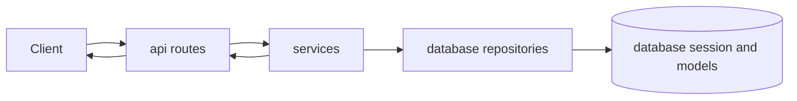

# Layered Architecture and Request Flow

TravelHub follows a **layered architecture** with a clear top-down request flow:

`api -> services -> database`

This structure is stated explicitly in the README and reflected in the repository layout. Each layer has a narrow responsibility:

- **`api/`** is the HTTP boundary and entrypoint layer.
- **`services/`** contains use-case orchestration and business rules.
- **`database/`** contains persistence models, session access, and repository implementations.
- **`schemas/`** defines request and response contracts used at the boundary.

The key architectural goal is separation of concerns: HTTP handling stays out of business logic, business logic stays out of persistence details, and data-shape validation stays separate from both.

## Request flow at a high level

A typical request moves through the system as follows:

1. An endpoint in `api/routes/*.py` receives request data in a schema object.
2. The route delegates to a service in `services/*.py`.
3. The service applies business rules and uses repositories in `database/repositories/*.py` to read or write state.
4. The service returns domain objects or results back to the route.
5. The route maps those results to a response schema for the API consumer.

This flow keeps the layers decoupled: routes do not implement core business rules, services do not expose SQL/ORM concerns, and repositories do not decide use-case behavior.

## Role of each layer

### API layer

The route modules in `api/routes/users.py`, `api/routes/bookings.py`, and `api/routes/destinations.py` form the presentation layer. Their responsibility is to:

- accept request-shaped inputs from `schemas/*.py`
- invoke the appropriate service or repository entrypoint
- translate domain results into response-shaped outputs
- handle HTTP-adjacent error mapping

The API layer is intentionally thin. For example, booking routes delegate to `BookingService`, while user routes use the user repository through API-level wiring. This means the API layer acts as an adapter between HTTP concerns and the internal application model, rather than as a place for business logic.

### Services layer

The `services/` package is the application’s business orchestration layer. It centralizes use-case logic such as booking creation, cancellation, and pricing. The service layer is responsible for:

- enforcing business rules
- coordinating multiple repositories or helper services
- deciding what should happen for a use case
- raising domain or application errors when rules are violated

`services/booking_service.py` is the clearest example: it validates booking dates, checks booking limits, calculates pricing, and persists the resulting booking through repositories. `services/pricing_service.py` provides the pricing rules used by booking creation, and `services/notification_service.py` contains notification-oriented behavior that remains separate from HTTP handling and persistence concerns.

### Database layer

The `database/` package owns the persistence boundary. Its repository modules, especially `database/repositories/booking_repository.py` and `database/repositories/user_repository.py`, encapsulate data access and hide how objects are stored in the backing session.

This layer is responsible for:

- retrieving and storing persistent state
- translating between stored objects and in-memory entities
- exposing repository methods that services can use without knowing storage details

The README describes this explicitly as a **Repository pattern** implementation. That design matters because it prevents service code from depending on low-level database mechanics.

### Schemas layer

The `schemas/` package defines the input and output contracts for the API boundary. `schemas/booking.py` and `schemas/user.py` define request and response shapes for bookings and users.

These schemas serve two architectural purposes:

- they validate and structure incoming data at the edge of the system
- they define stable response shapes without exposing internal persistence models directly

That separation helps keep internal models flexible while maintaining consistent API contracts.

## Boundaries and allowed dependencies

The dependency direction is intentionally one-way:

- `api` depends on `services`, `schemas`, and selected infrastructure helpers
- `services` depends on `database`, `core`, and utility modules
- `database` depends on its own models and session abstraction
- `schemas` remain boundary types and should not depend on business logic

This arrangement keeps higher-level concerns independent of lower-level implementation details. In practice, it means:

- routes should not contain persistence logic
- services should not know how endpoints are exposed over HTTP
- repositories should not enforce use-case rules
- schemas should not embed storage behavior

## Concrete request paths

### Booking creation

The booking flow demonstrates the layered style most clearly:

- `api/routes/bookings.py` receives a `BookingCreateRequest`
- the route calls `BookingService.create_booking`
- the service validates business conditions, calculates price, and stores the booking through `BookingRepository`
- the route maps the created booking to `BookingResponse`

That path shows the canonical responsibility split: HTTP input handling in the API layer, orchestration in services, and persistence in repositories.

### User creation

`api/routes/users.py` follows a similar boundary pattern, but with a lighter flow:

- request data is received as `UserCreateRequest`
- the route validates basic input concerns such as email format
- the route uses the user repository to store the user
- the route returns `UserResponse`

This still fits the layered model: the API remains the adapter, while storage is delegated to the persistence layer.

### Destination lookup

`api/routes/destinations.py` is even thinner. It serves as a read-only API surface over destination data and uses the database session directly for lookup-oriented read access. Architecturally, it still stays within the presentation boundary: its job is to expose destination data, not to own business rules about destinations.

## Wiring and composition

The repository structure suggests a composition root in `main.py`, where the layers are ultimately assembled into a runnable application. That file is the place where routes, services, repositories, and database/session components are connected, but the detailed startup assembly belongs to the separate startup documentation.

## Why the separation matters

This layered architecture provides several benefits:

- **Cohesion**: each package has one primary reason to change
- **Testability**: services and repositories can be exercised independently
- **Maintainability**: changes in storage or HTTP shape do not force changes in business rules
- **Substitutability**: repositories can be replaced without rewriting service logic
- **Clarity**: request flow is explicit and easy to reason about

In short, TravelHub is organized as a classic layered application where `api` adapts HTTP requests, `services` implement use cases, `database` hides persistence details, and `schemas` define the data contracts that connect the layers.