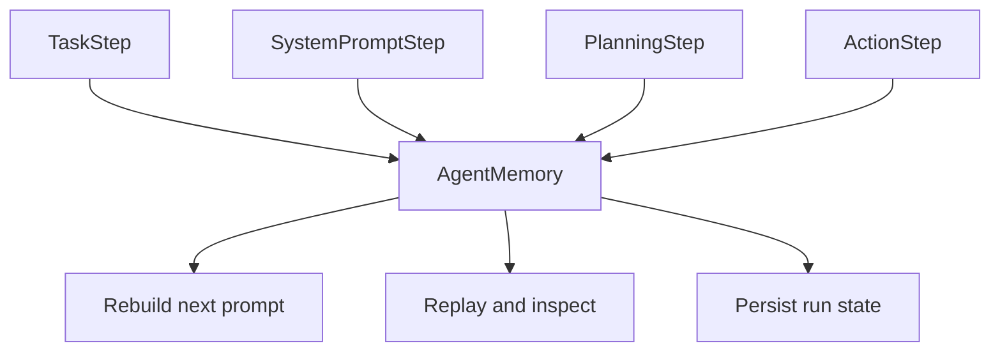

# Memory, Serialization, and Run State

`smolagents` treats execution state as a first-class part of the agent loop, not as an after-the-fact log. The design in [`src/smolagents/memory.py`](src/smolagents/memory.py) and [`src/smolagents/serialization.py`](src/smolagents/serialization.py) shows two complementary concerns:

1. **Operational memory** for reconstructing the next model input during multi-step execution.
2. **Persistable artifacts** for inspection, replay, and safe transport across process or backend boundaries.

This split is what makes agent runs reproducible, debuggable, and resumable.

## Memory as control-loop state

`AgentMemory` is the central state container for an agent run. It stores:

- the **system prompt** as a dedicated step,
- the ordered sequence of **task**, **planning**, and **action** steps,
- per-step data needed to rebuild the next prompt or replay the run.

This is not passive telemetry. Each step class can be converted back into chat messages through `to_messages`, which means memory is directly tied to prompt reconstruction. In other words, the agent does not just remember what happened; it reuses that history as part of the next reasoning cycle.

The step model is intentionally heterogeneous:

- `TaskStep` captures the incoming user task and optional task images.
- `PlanningStep` records a planning pass and can be replayed as a short instruction.
- `ActionStep` captures the core execution turn, including model input, model output, tool calls, observations, timing, token usage, and final-answer status.
- `SystemPromptStep` preserves the root instruction context.
- `FinalAnswerStep` represents terminal output.

This organization reflects the framework’s control flow: the agent alternates between model reasoning, tool execution, and memory updates. The memory object is the canonical record of those transitions.

## Prompt reconstruction and replay

The architecture in `memory.py` shows that each step knows how to project itself back into messages. That enables two important behaviors:

- **Reconstruction of context** for the next generation step.
- **Replay and inspection** of an existing run.

`ActionStep.to_messages` rebuilds the assistant/tool-response sequence that the model should see on the next turn. `PlanningStep.to_messages` inserts a compact plan-and-continue pattern. `TaskStep` and `SystemPromptStep` provide the foundational context. This means memory is not merely stored for audit; it is the substrate used to continue execution.

The `replay` method reinforces this role by rendering the run as a structured narrative through `AgentLogger`. The code treats replay as a debug-oriented projection of the same state, not as a separate artifact pipeline.

## Persistent run artifacts and inspectability

The state stored in memory is designed to be serialized into inspectable artifacts. `get_succinct_steps` and `get_full_steps` expose two levels of detail:

- **Succinct** output keeps the run compact and omits full model input messages.
- **Full** output preserves the full step payload needed for deep inspection.

This distinction is architectural rather than cosmetic. It supports different consumers of run state:

- lightweight run summaries,
- debugging views,
- external monitoring and observability tools,
- saved execution traces for later analysis.

The `examples/inspect_multiagent_run.py` script illustrates this inspection-oriented usage: the run is instrumented externally while the agent still executes normally. That reflects a broader design goal: memory should be rich enough to inspect multi-agent behavior without coupling the core execution loop to a specific UI or observability backend.

## Serialization as a safety boundary

`SafeSerializer` in [`src/smolagents/serialization.py`](src/smolagents/serialization.py) addresses a separate but related problem: moving run state and runtime objects across boundaries safely.

The module is explicitly oriented around **JSON-first serialization** with type markers, while reserving pickle for explicitly allowed legacy or trusted cases. That choice matters because agent state can include:

- primitive values and nested collections,
- datetimes, paths, bytes, and complex numbers,
- optional types such as numpy arrays and PIL images,
- dataclass instances,
- tool or executor payloads that need transport between processes.

The serializer therefore acts as an interoperability layer for the agent ecosystem, especially where local execution, remote execution, or persistence need to exchange structured data.

### Safe-by-default format

The design uses a prefix-based format:

- `safe:` for JSON-safe serialized values,
- `pickle:` only when insecure fallback is explicitly enabled.

The safe path is the default. This is important architecturally because it lets the library serialize common run artifacts without making the runtime depend on unsafe object graph serialization.

The tests in [`tests/test_serialization.py`](tests/test_serialization.py) show the intended boundary:

- safe mode accepts supported structured data and rejects arbitrary custom objects,
- pickle fallback exists but emits warnings,
- loading pickle data is blocked unless explicitly permitted,
- safe serialization is preferred even when pickle is allowed.

That behavior keeps serialization aligned with the framework’s broader safety posture.

## Serialization for remote and resumable execution

The serializer is not only for saving files. It is also used as a transport format for executor communication and sandboxed execution. The generated deserializer code helpers in `SafeSerializer` make the serialization contract portable into isolated environments without duplicating implementation details.

That matters for run state because a multi-step agent can cross boundaries where Python object identity is not preserved:

- local process to remote executor,
- host environment to sandbox,
- live execution to persisted trace,
- persisted trace back to an inspectable in-memory representation.

In these cases, the framework depends on serialization to preserve the useful parts of state, not the exact runtime identity of every object.

## Architectural implications

The memory and serialization layers form a clear division of responsibility:

- **Memory** stores the semantic history of the run and feeds the control loop.
- **Serialization** makes that history and its artifacts portable, inspectable, and safe to exchange.
- **Run state** is therefore an active execution concern, not an external logging concern.

This design is what enables reproducibility in `smolagents`: the agent can be examined after the fact, but more importantly, it can continue from the same contextual substrate that produced the original behavior in the first place.