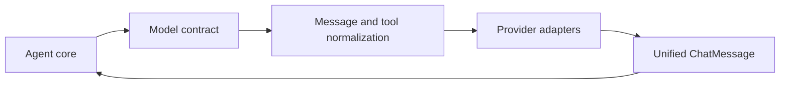

# Model Abstraction and Provider Integration

`smolagents` keeps the rest of the framework decoupled from any specific LLM vendor by funneling all inference through a small model contract defined in `src/smolagents/models.py`. Agents do not talk to OpenAI, Hugging Face, LiteLLM, or local runtimes directly; they call a `Model` interface that normalizes message formatting, tool metadata, stop handling, streaming, and token accounting. This is what makes the agent core reusable across execution styles described in [Architecture Overview and Core Loop](Architecture-Overview-and-Core-Loop.md).

## Architectural role of the model layer

The model layer is an adapter boundary:

- **Core contract**: subclasses implement `generate` and optionally `generate_stream`.
- **Common request preparation**: the base class builds provider-ready kwargs through `_prepare_completion_kwargs`.
- **Common response shape**: all backends return `ChatMessage` objects with standardized roles, content, tool calls, raw response payloads, and token usage.
- **Common tool schema translation**: tools are converted into JSON schemas before being attached to model requests.
- **Common message normalization**: chat history is cleaned into a provider-compatible payload before inference.

This means the agent loop can focus on planning and tool execution, while the model layer absorbs provider-specific differences.

## Normalization before provider calls

The base `Model` class centralizes the cross-provider translation logic:

- **Role conversion**: internal roles such as `tool-call` and `tool-response` are mapped into provider-facing roles through `tool_role_conversions`, with backends able to override this mapping.
- **Message cleanup**: `get_clean_message_list` merges adjacent messages of the same role, optionally flattens them into plain text, and handles image payload encoding or image URL conversion when needed.
- **Tool attachment**: `get_tool_json_schema` converts `Tool` objects into the function-calling schema expected by chat APIs.
- **Stop sequences**: `supports_stop_parameter` gates whether a backend can receive native stop tokens. For models that do not support them, `remove_content_after_stop_sequences` trims the output after generation.
- **Tool call parsing**: `parse_tool_calls` and `get_tool_call_from_text` support backends that return tool calls as text instead of structured objects.

This normalization layer is what allows agent code to stay agnostic to whether a backend returns native tool-call objects, plain text, or streamed deltas.

## Backend families exposed by the package

The implementation in `models.py` groups backends into a few adapter families, all inheriting from the same base contract.

### Local and library-backed runtimes

These adapters run inference through local libraries:

- **`TransformersModel`** for Hugging Face Transformers
- **`MLXModel`** for Apple Silicon MLX
- **`VLLMModel`** for vLLM serving and local inference

These backends reuse the same message preparation and `ChatMessage` output model, while adapting prompt construction and generation arguments to each runtime. For example, `TransformersModel` handles both text-only and vision-capable models by choosing between tokenizer and processor-based paths.

### API-backed providers

These adapters wrap external APIs behind a shared interface:

- **`OpenAIModel`** and its alias `OpenAIServerModel`
- **`AzureOpenAIModel`** and its alias `AzureOpenAIServerModel`
- **`LiteLLMModel`**
- **`LiteLLMRouterModel`**
- **`InferenceClientModel`**
- **`AmazonBedrockModel`** and its alias `AmazonBedrockServerModel`

The important design choice is that these are not separate feature sets for the agent layer. They are interchangeable implementations of the same `Model` API, differing only in how they create clients and transform the prepared request into a provider call.

### Provider adapters and routing

`LiteLLMModel` is a broad compatibility adapter for OpenAI-style and other supported providers via LiteLLM. `LiteLLMRouterModel` adds routing on top of that same compatibility layer, but still exposes the same model interface to agents.

`InferenceClientModel` plays a similar role for Hugging Face Inference Providers and can be pointed either at serverless providers or a custom base URL. The architecture here is deliberately provider-neutral: the adapter encapsulates provider selection, authentication, and request shape so the rest of the system only sees a `Model`.

## Unified response handling

All adapters convert provider results into the same internal message shape:

- `ChatMessage.role`
- `ChatMessage.content`
- `ChatMessage.tool_calls`
- `ChatMessage.raw`
- `ChatMessage.token_usage`

The tests in `tests/test_models.py` exercise this normalization directly. They verify that:

- message preparation respects precedence between constructor defaults, call-time kwargs, and removed parameters
- `ChatMessage` can be serialized and reconstructed safely
- tool call payloads from different providers are coerced into a consistent dataclass form
- stop-sequence handling is consistent across backends
- streaming deltas can be agglomerated into a full assistant message

That consistency is the architectural contract the agent layer relies on.

## Security and serialization considerations

The model layer also participates in safe persistence and reconstruction:

- `Model.to_dict` exports configuration but intentionally avoids leaking secrets such as API keys or tokens.
- `MODEL_REGISTRY` restricts deserialization to an allowlist of known model classes.
- `Model.from_dict` reconstructs only supported backend types from structured configuration.

This is a deliberate boundary: the framework can save and reload model configuration without turning deserialization into arbitrary code execution.

## Public surface and package assembly

The public package surface in `src/smolagents/__init__.py` re-exports the model adapters alongside agents, tools, memory, and execution helpers. This makes model selection part of the intended top-level API rather than an internal implementation detail. In practice, the repository presents model choice as an interchangeable configuration point, which is also reflected in `examples/agent_from_any_llm.py`: the same agent and tool setup can be paired with `InferenceClientModel`, `TransformersModel`, `LiteLLMModel`, or `OpenAIModel` without changing the agent logic.

## Why this boundary matters

This abstraction keeps the framework stable as providers change. Agents depend on:

- a common `generate` interface
- standardized message and tool-call representations
- a uniform way to supply tools and stop sequences
- consistent token accounting and streaming behavior

Because of that, the rest of `smolagents` can remain model-agnostic while still supporting local runtimes, inference gateways, OpenAI-compatible APIs, cloud providers, and routed backends through the same integration point.