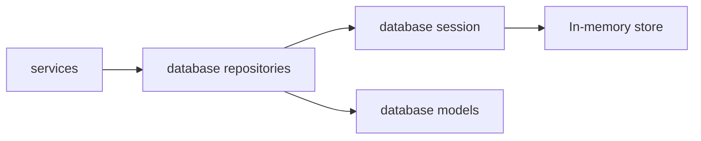
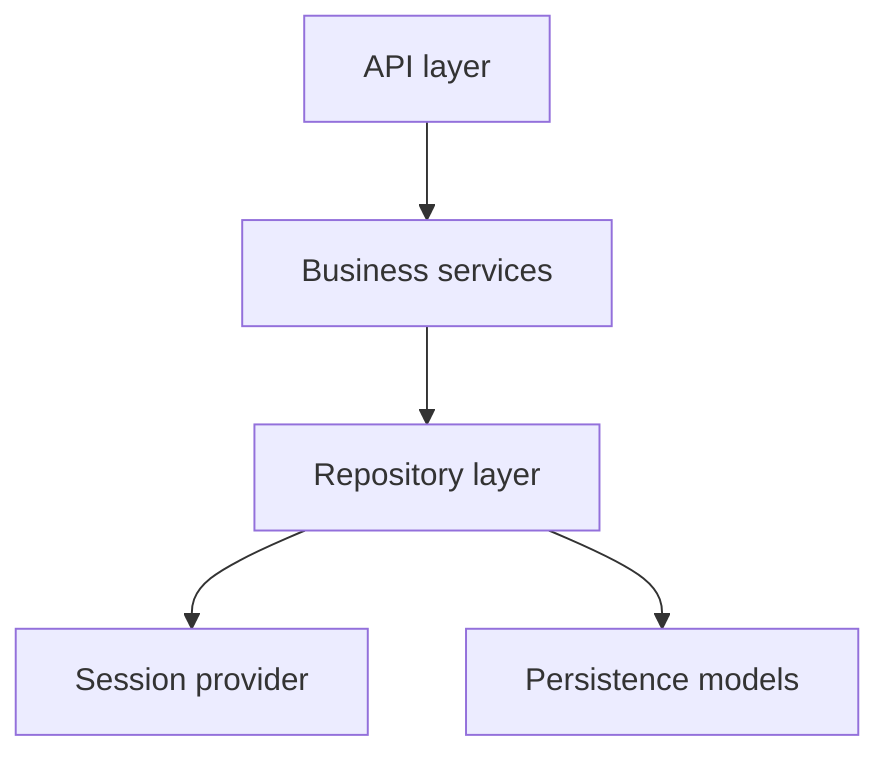

# Persistence Layer and Repository Pattern

TravelHub’s persistence layer is organized around the **Repository pattern**: the rest of the application talks to repository objects instead of directly manipulating storage structures or ORM details. In this repository, that role is implemented by `database/repositories/booking_repository.py` and `database/repositories/user_repository.py`, with `database/session.py` and `database/models.py` providing the storage foundation.

## Architectural role

The repositories act as the **data-access boundary** for the application. Their responsibility is to expose entity-focused operations such as retrieving, adding, updating, or removing persisted records, while hiding how those records are actually stored. This keeps the service layer focused on business decisions and use-case orchestration, rather than on persistence mechanics.

The README explicitly frames `database/` as the access layer and identifies it as the place where the Repository pattern lives. That means the persistence layer is not just a collection of queries: it is the abstraction that decouples the rest of the system from the storage implementation.

## Structure of the persistence layer

### `database/models.py`
`database/models.py` defines the persistence-side representation of the domain: `User`, `Destination`, `Booking`, and the `BookingStatus` enum. These are plain dataclass-based entities, which means they serve as the shape of stored data rather than as behavior-rich domain objects. The file deliberately contains no business logic, reinforcing a separation between **data shape** and **use-case policy**.

### `database/session.py`
`database/session.py` provides the storage access point through `get_db()`. In the current implementation, the “database” is an in-memory object, but the module is written as a persistence abstraction rather than a one-off test helper. Its documented purpose is to simulate a session-like interface so that the rest of the application can remain stable if the backing store is replaced later with a real database or ORM session.

This is an important architectural decision: the repositories depend on a session provider, not on concrete storage internals. That makes the session module the main seam for swapping persistence implementations.

### Repository implementations
`BookingRepository` and `UserRepository` are the concrete repository implementations for their respective aggregates.

- `BookingRepository` exposes booking-centric access methods such as lookup by identifier, listing bookings for a user, and basic persistence lifecycle operations.
- `UserRepository` exposes user-centric access methods such as lookup by identifier or email, and creation of new users.

The two repositories follow the same overall convention:
- instantiate a database handle via `get_db`
- operate on entity collections owned by that database handle
- keep storage-specific details encapsulated inside the repository layer

That shared shape is a repository-level convention worth noting, even though there is no separate base class. The design is intentionally simple and explicit.

## Responsibilities kept inside the repository boundary

The repository layer should own concerns that are inherently persistence-oriented:

- locating entities in storage
- translating between entity identity and stored records
- assigning identifiers where needed
- mutating the underlying store
- shielding higher layers from storage layout details

By contrast, it should **not** contain business rules such as booking validation, pricing policy, notification logic, or workflow coordination. Those belong in the service layer. For example, whether a booking is allowed, what total price it should have, or when a booking should be confirmed is a business decision; the repository should only persist the resulting state.

This boundary keeps the system cohesive:
- services decide **what should happen**
- repositories decide **how data is stored and retrieved**

## Why this pattern matters

### Isolation from SQL and ORM details
The repository layer is the only part of the application that should know how persistence works. In this codebase, that isolation is especially visible because the current storage backend is in-memory, yet the surrounding architecture is already shaped as if a real database were present. The persistence API is therefore treated as an implementation detail, not as a domain concern.

### Testability
Because services depend on repositories rather than on a database API directly, persistence can be replaced or simulated in tests. This makes the architecture easier to unit test: business logic can be exercised without requiring a real database connection, and repository behavior can be validated independently from the service rules.

### Replaceable storage backend
`database/session.py` is the key replacement seam. Since repositories obtain their data access through that module, the application can later move from the current in-memory store to a real database with minimal impact on the rest of the codebase, provided the repository contract remains stable.

## Relationship to the rest of the architecture

The persistence layer sits below the business services and above the concrete storage mechanism. It does not expose HTTP concerns, serialization concerns, or application workflows. Instead, it provides a stable data-access API that higher layers can rely on.

That position in the architecture can be summarized as follows:

The result is a clean separation of responsibilities: the API handles transport, services handle orchestration, repositories handle persistence, and models define the stored shape of the data.