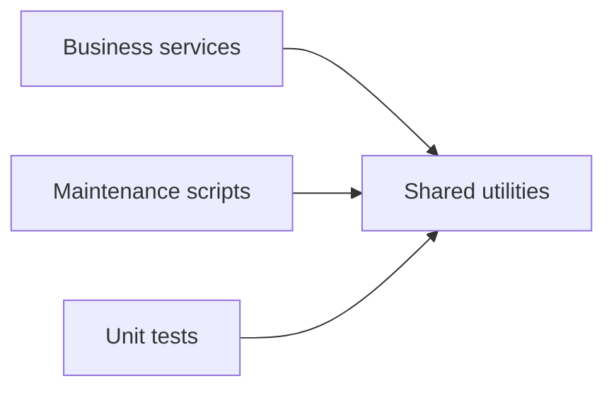

# Supporting Utilities, Scripts, and Test Support

This repository keeps a clear boundary between the **core request path** and the **supporting code** that makes the application easier to maintain, validate, and operate. The files in `utils/`, `scripts/`, and `tests/` are not part of the HTTP flow described in [Layered Architecture and Request Flow](Layered-Architecture-and-Request-Flow.md); instead, they provide reusable helpers, manual operational tooling, and architecture-aligned tests.

## Shared utilities stay outside the core layers

The modules under `utils/` encapsulate small pieces of logic that would otherwise be duplicated across services, scripts, or validation code:

- `utils/date_helpers.py` centralizes date arithmetic and date-range checks.
- `utils/formatters.py` centralizes presentation-oriented transformations such as currency formatting, slug generation, and text truncation.
- `utils/validators.py` centralizes generic input validation such as email format and positive-integer checks.

Architecturally, these helpers are intentionally **generic**. They do not own business workflows, persistence, or HTTP concerns; they are reusable building blocks that can be called from services or other supporting code when a small, focused operation would otherwise be repeated. This keeps domain services focused on orchestration rather than low-level utility work.

## Scripts are operational tools, not application flow

The `scripts/` directory contains maintenance entry points that operate on the same data model and session layer as the application, but outside the request lifecycle:

- `scripts/seed_data.py` inserts example `Destination` records for manual or bootstrap use.
- `scripts/generate_report.py` reads persisted bookings and produces a text report of confirmed reservations.

These scripts are deliberate **out-of-band tooling**. They use persistence primitives directly because their purpose is administrative rather than transactional. That separation matters: the API layer remains the canonical path for user-facing operations, while scripts support setup and reporting without becoming part of the runtime service surface.

In architectural terms, the scripts demonstrate that not every interaction with the system belongs in the layered request path. Some tasks are best modeled as one-off or scheduled utilities that reuse the same data structures and session access, but do not introduce new business APIs.

## Tests mirror the architecture by targeting behavior at the right layer

The test files reflect the repository’s layering choices by validating behavior where it belongs:

- `tests/test_booking_service.py` exercises `BookingService` directly, focusing on use-case behavior rather than HTTP or database mechanics.
- `tests/test_validators.py` verifies the generic validation helpers in `utils/validators.py`.

This is a strong architectural signal: service tests validate orchestration and business outcomes, while utility tests validate shared rules in isolation. The tests avoid coupling to route handlers or concrete persistence details, which helps preserve the boundaries between layers and keeps failures localized to the appropriate responsibility.

## Why these support modules matter

Taken together, these support modules serve three design goals:

1. **Reduce duplication** by centralizing reusable date, formatting, and validation logic.
2. **Keep the core layers cohesive** by preventing small helper concerns from leaking into services or routes.
3. **Support maintenance and verification** through scripts and tests that operate alongside the application, not inside the request flow.

This makes the codebase easier to evolve: business logic remains concentrated in the service layer, persistence remains isolated in repositories, and these supporting modules provide the shared infrastructure around them without blurring responsibility boundaries.