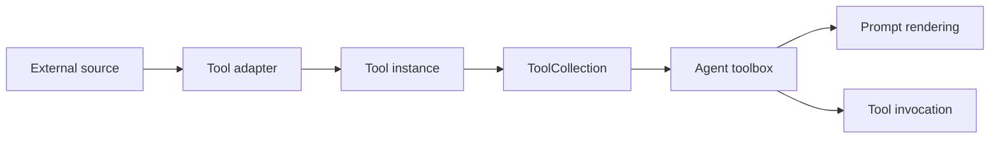

# Tool System and Extension Points

The tool layer is one of the main extension boundaries in smolagents. It is designed so agents can consume capabilities from many sources without changing the agent core: native Python tools, user-defined tools, Hub-hosted tools, MCP tools, LangChain tools, Gradio tools, and Hugging Face Space-backed tools are all normalized into the same interface in `src/smolagents/tools.py`.

At a high level, the architecture separates three concerns:

1. **Tool definition**: how a capability is described to the agent.
2. **Tool validation**: how the library enforces that a tool is safe and introspectable.
3. **Tool adaptation and collection**: how external tool sources are imported into the same runtime shape.

This keeps the agent loop focused on orchestration, while tool integration remains open-ended. See also [Architecture Overview and Core Loop](Architecture-Overview-and-Core-Loop.md) for how tools are consumed during execution.

## Core tool contract

The fundamental abstraction is `Tool`, built on top of `BaseTool` in `src/smolagents/tools.py`. A tool exposes:

- a stable `name`
- a natural-language `description`
- an `inputs` schema
- an `output_type`
- a callable `forward` implementation

The agent interacts with tools through `__call__`, not by reaching into implementation details. That method also handles lazy initialization through `setup`, which allows expensive resources to be loaded only on first use. This is especially important for model-backed or remote tools.

The design deliberately keeps the runtime contract small:

- tool metadata is class-level and introspectable
- execution is instance-level
- initialization can be deferred
- inputs and outputs can be sanitized for agent-safe use

### Structured prompt representation

Each tool can render itself into prompt-friendly forms:

- `to_code_prompt`
- `to_tool_calling_prompt`

These methods translate the tool schema into either a code-style signature or a concise tool-call description. This is the bridge between the tool registry and the agent prompting layer. In other words, tools are not just executable objects; they are also prompt artifacts.

## Tool schemas and type-driven discovery

Tool definitions are schema-driven. The library derives tool metadata from Python signatures, type hints, and docstrings, then converts them into a JSON-schema-like representation. This is handled by the decorator-based path and by helper utilities in `src/smolagents/tools.py` and `_function_type_hints_utils`.

The `@tool` decorator is the most ergonomic entry point:

- it converts a regular function into a `Tool`
- it reads type hints for inputs and return values
- it extracts the docstring as the description
- it preserves the original function semantics while adding tool metadata

This makes tool creation lightweight without sacrificing machine-readable structure. The tests in `tests/test_tools.py` show that the decorator supports:

- optional arguments and nullable inputs
- `Any`
- arrays and tuples
- `Literal` values and enums
- union-like return handling
- multiline docstrings and multiline signatures

The result is that a function can become a first-class agent tool without requiring a separate interface definition format.

## Validation as an architectural guardrail

Tool validation is intentionally strict. The `tool_validation.py` module contains static checks that ensure tools remain self-contained and serializable enough to be inspected or exported.

Two validation layers are important:

- **`validate_tool_attributes`**: checks class-level tool structure
- **`MethodChecker`**: analyzes method ASTs for undefined names and import rules

These checks enforce several architectural constraints:

- `name` must be a valid Python identifier
- required class attributes must exist and have the right types
- `inputs` entries must contain `type` and `description`
- input types must belong to the approved type vocabulary
- `forward` parameters must match `inputs` unless the tool opts out
- methods should not depend on undeclared local state
- imports are expected to be package-level or local to methods, not hidden in unsupported ways

This matters because smolagents does not treat tools as opaque black boxes. It needs to inspect them for prompt generation, code export, Hub publication, and agent-side validation.

The tests in `tests/test_tools.py` verify that invalid tool shapes fail early, for example when:

- `output_type` is missing
- `inputs` types are invalid
- `forward` and `inputs` disagree
- required constructor arguments prevent safe reconstruction
- non-self-contained code prevents saving

In architectural terms, validation preserves the boundary between **agent-visible tool metadata** and **tool implementation details**.

## Serialization and reproducibility of tools

Tools can be serialized into code-bearing dictionaries via `to_dict`, and rehydrated via `from_dict`. This is not just persistence plumbing; it is a design decision that keeps tools portable across local execution, Hub publication, and remote reuse.

A serialized tool includes:

- its name
- source code
- inferred requirements
- optional output schema

That means tools are represented as code artifacts, not just opaque pickled objects. This is safer and more transparent for an agent framework that expects tools to be inspectable and potentially shared.

The same source-first philosophy appears in the Hub and Space integration paths.

## Tool adapters for external ecosystems

smolagents treats integration as a wrapper problem: external tool providers are adapted into the `Tool` interface rather than supported through special-case agent logic.

### Hugging Face Hub tools

`Tool.from_hub` downloads a tool from a Space repository, with an explicit `trust_remote_code` gate. This is a security and trust boundary, not merely an API convenience. The tool is executed locally after download, so the library requires explicit acknowledgment before loading remote code.

### Hugging Face Space tools

`Tool.from_space` wraps a Space as a callable tool using `gradio_client`. It introspects the Space API, maps input types into tool schema entries, and normalizes outputs into agent-friendly types such as image or audio wrappers when applicable.

### LangChain tools

`Tool.from_langchain` wraps a LangChain tool by translating its args metadata into the `Tool` schema and forwarding execution through the LangChain runtime.

### Gradio tools

`Tool.from_gradio` adapts a Gradio tool into the same contract, keeping the agent side agnostic to the original UI or serving layer.

### MCP tool collections

`ToolCollection.from_mcp` loads multiple tools from an MCP server and returns them as a collection usable by agents. This is important because it treats MCP as a discovery mechanism, not as a separate execution model. The tools are still just `Tool` instances from the agent’s perspective.

### Hub collections

`ToolCollection.from_hub` loads all Space-backed tools from a Hugging Face collection and exposes them as a list. This gives the framework a bulk-loading abstraction that fits naturally into agent assembly.

## Default tools as convenience, not as a closed toolbox

`src/smolagents/default_tools.py` provides a set of ready-made tools that cover common agent needs:

- `PythonInterpreterTool`
- `FinalAnswerTool`
- `UserInputTool`
- web search tools
- `VisitWebpageTool`
- `WikipediaSearchTool`
- `SpeechToTextTool`

These are conveniences, not architectural constraints. They demonstrate the intended capabilities of the framework, but they are not required for agent operation. An agent can be assembled with any custom tool set, and the default tools simply lower the cost of getting started.

A few design patterns stand out:

- **Execution-backed tools**: `PythonInterpreterTool` delegates to the local Python executor and restricts imports.
- **Finalization tool**: `FinalAnswerTool` gives the agent a standardized way to emit the final response.
- **Interactive tool**: `UserInputTool` bridges agent action back to human input.
- **Remote or network-backed tools**: search and webpage tools encapsulate external APIs behind the same callable contract.
- **Pipeline-based tools**: `SpeechToTextTool` inherits from `PipelineTool`, showing how model-driven tools can be packaged with deferred loading and device setup.

The tests in `tests/test_default_tools.py` confirm that these tools behave like normal tools from the agent’s point of view: they expose schemas, accept sanitized inputs, and return values in the expected agent types.

## Tool collections as composition units

`ToolCollection` is a small but important composition abstraction. It allows the framework to treat a set of tools as a unit, especially when loaded from Hub collections or MCP servers.

This is useful for two reasons:

1. it separates **discovery** from **agent wiring**
2. it avoids hardcoding any single source of tools into the agent core

A collection can be unpacked into the agent toolbox with standard Python composition, so the agent never needs to know whether a tool came from the local codebase, a remote Space, or an MCP server.

## Safety and invocation boundaries

The tool layer combines flexibility with explicit safety checks:

- schema validation ensures agent-visible contracts are well-formed
- `validate_tool_arguments` checks runtime arguments against the schema
- `trust_remote_code` is required for remote-loaded tools and collections
- `sanitize_inputs_outputs` normalizes values into agent-compatible types

This means tool invocation is not simply dynamic dispatch; it is guarded dynamic dispatch. The framework accepts heterogeneous tools, but only after they have been normalized into a predictable interface.

## Architectural summary

The tool system is a boundary layer between agent reasoning and external capability. Its main design choice is to unify many integration styles under a single `Tool` abstraction while keeping validation, serialization, and adapter logic explicit.

That gives smolagents:

- a small agent core
- a reusable tool contract
- open-ended integration points
- safe tool discovery and invocation
- convenient defaults without lock-in

In practice, this is what makes the framework tool-agnostic rather than tool-specific.